<div align="center">
  
</div>

<br/>

<div align="center">

[](https://github.com/12Mishra)
&nbsp;

&nbsp;


</div>

---

## 🏎️ &nbsp;DRIVER PROFILE

<table>
  <tr>
    <td><b>👤 &nbsp;Name</b></td>
    <td>Abhyuday Mishra</td>
    <td><b>🌍 &nbsp;Nationality</b></td>
    <td>🇮🇳 &nbsp;Indian</td>
  </tr>
  <tr>
    <td><b>🏁 &nbsp;Role</b></td>
    <td>Full Stack Developer</td>
    <td><b>📍 &nbsp;Base</b></td>
    <td>New Delhi / Patiala, India</td>
  </tr>
  <tr>
    <td><b>🎓 &nbsp;Team</b></td>
    <td>Thapar Institute (ECE, 2027)</td>
    <td><b>⚡ &nbsp;CGPA</b></td>
    <td>8.78 / 10.0</td>
  </tr>
  <tr>
    <td><b>🎯 &nbsp;Current Focus</b></td>
    <td>MERN Stack · Next.js · System Design</td>
    <td><b>🔗 &nbsp;Portfolio</b></td>
    <td><a href="https://abhyudaymishra.in">abhyudaymishra.in</a></td>
  </tr>
</table>

<br/>

---

## 📋 &nbsp;ABOUT THE DRIVER

```
▶  Driven by curiosity — focused by solutions.

   I build end-to-end web applications with clean architecture and ship
   fast. From scaling real-time engines to e-learning platforms serving
   15+ schools, I race toward impact on every lap.

   Currently racing in:  Web Development · MERN Stack · Next.js
   Open for:             Collaboration on full-stack Next.js projects
   Ask me about:         React.js · Next.js · Web Development
   Personal radio:       abhyu.mishra04@gmail.com
   Fastest lap:          Node-Scale Engine — real-time auto-scaling sim
```

<br/>

---

## ⚙️ &nbsp;CAR SETUP &nbsp;/&nbsp; TECH STACK

> *Every championship-winning car starts with the right components.*

**Frontend — Aerodynamics**


**Backend — Power Unit**


**Databases — Fuel & Data**


**DevOps & Tools — Pit Crew**


**Languages — Core Engine**


<br/>

---

## 🏆 &nbsp;RACE STATISTICS

<div align="center">


&nbsp;&nbsp;


<br/><br/>


</div>

<br/>

---

## 🚀 &nbsp;PODIUM FINISHES &nbsp;/&nbsp; FEATURED PROJECTS

> *These are the race wins. The moments that matter.*

<div align="center">

<a href="https://github.com/12Mishra/node-scale-engine">
  
</a>
&nbsp;
<a href="https://github.com/12Mishra/drop-and-sync">
  
</a>

</div>

<br/>

### &nbsp;🥇 &nbsp;Node-Scale Engine &nbsp;·&nbsp; *Mar 2026*
> Real-time auto-scaling simulation using Node.js Cluster Module with a master–worker IPC architecture. Live monitoring dashboard built with Next.js + Recharts, streaming metrics via Server-Sent Events.

**Stack:** `Node.js` `Cluster Module` `Next.js` `Recharts` `SSE`

### &nbsp;🥈 &nbsp;Drop and Sync &nbsp;·&nbsp; *Mar 2025*
> Full-stack file management app with secure AWS S3 uploads, NextAuth session management, shareable links, QR code generation, and AI-powered file tagging via the Gemini API.

**Stack:** `Next.js` `PostgreSQL` `AWS S3` `Gemini API` `NextAuth`

<br/>

---

## 🏅 &nbsp;ACHIEVEMENTS &nbsp;/&nbsp; HALL OF FAME

```
🏆  CodeChef 1200+ Rating        —  150+ DSA problems solved in C++
🎓  MERN Stack Certified (Udemy) —  React · Node.js · Express.js · MongoDB
🚀  Smart India Hackathon 2024   —  Selected from Internal Round among 500+ participants
```

<br/>

---

## 📻 &nbsp;TEAM RADIO &nbsp;/&nbsp; CONTACT

> *"Copy that, box box box — let's connect."*

<div align="center">

[](https://linkedin.com/in/abhyuday-mishra12/)
&nbsp;
[](https://abhyudaymishra.in)
&nbsp;
[](https://github.com/12Mishra)
&nbsp;
[](mailto:abhyu.mishra04@gmail.com)

</div>

<br/>

---

<div align="center">

```
🏁  CHECKERED FLAG  ·  LIGHTS OUT AND AWAY WE GO  ·  🏁
```


&nbsp;

&nbsp;


<sub>Inspired by the <b>Mercedes AMG Petronas Formula One Team</b> — Because winning is a habit.</sub>

</div>
